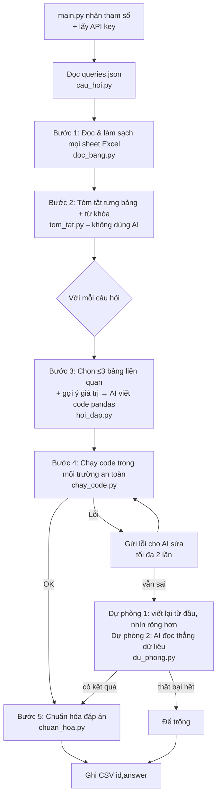

# SmartExcel – Cách hoạt động và luồng xử lý

Tài liệu này tóm tắt toàn bộ dự án: chương trình làm gì, dữ liệu đi qua những bước nào,
AI được gọi ở đâu và **API key phải đặt ở đâu**.

---

## 1. 🔑 API key – đặt ở đâu?

Dự án dùng **Qwen 3.7 Flash** (`qwen/qwen3.7-flash`) qua **OpenRouter** – gọi API qua Internet,
**không dùng Gemini, không dùng Ollama** (không cần cài model trên máy).

> ⚠️ Key của Gemini (Google AI Studio) **không dùng được** ở đây. Bạn cần key **OpenRouter**:
> đăng nhập https://openrouter.ai → **Keys** → **Create Key**. Key có dạng `sk-or-v1-...`.

Chương trình tìm key theo thứ tự ưu tiên sau (gặp chỗ nào có trước thì dùng chỗ đó):

| # | Đặt key ở đâu | Khi nào dùng | Cách làm |
|---|---|---|---|
| 1 | Tham số `--openrouter-key` | **Máy chấm** dùng cách này | `python main.py ... --openrouter-key sk-or-v1-...` |
| 2 | Biến môi trường `OPENROUTER_API_KEY` | Chạy trên máy mình | PowerShell: `$env:OPENROUTER_API_KEY="sk-or-v1-..."` |
| 3 | **File `.env` ở thư mục gốc** ⭐ (khuyên dùng) | Chạy trên máy mình, khỏi gõ lại | Xem bên dưới |

### Cách dùng file `.env` (khuyên dùng khi test trên máy)

1. Copy file mẫu [`.env.example`](.env.example) thành `.env` (cùng thư mục với `main.py`):
   ```
   SmartExcel/
   ├── .env            ← TẠO FILE NÀY
   ├── .env.example    ← file mẫu
   ├── main.py
   └── smartexcel/
   ```
2. Mở `.env`, dán key vào sau dấu `=`:
   ```
   OPENROUTER_API_KEY=sk-or-v1-xxxxxxxxxxxxxxxxxxxxxxxx
   ```
3. Chạy bình thường, không cần gõ `--key` nữa:
   ```
   python tools/cham_diem.py
   python main.py --xlsx-dir test_data/xlsx_files --queries test_data/queries.json --output test_data/output/submission.csv
   ```

Code đọc key nằm ở [`smartexcel/cau_hinh.py`](smartexcel/cau_hinh.py) (hàm `lay_key()`).
Tên model và địa chỉ API cũng nằm ở file này (`MODEL`, `BASE_URL`) – muốn đổi model chỉ cần sửa 1 chỗ.

### ⚠️ An toàn cho key
- `.env` đã có trong [`.gitignore`](.gitignore) → **không bị commit** lên GitHub.
- `Dockerfile` chỉ copy `main.py` và `smartexcel/` → `.env` **không lọt vào Docker image**.
- **Không** đưa `.env` vào file ZIP nộp bài. **Không** dán key thẳng vào file `.py`.

---

## 2. Chương trình làm gì?

**Đầu vào:** một thư mục file Excel (`--xlsx-dir`) + file câu hỏi JSON (`--queries`).
**Đầu ra:** file CSV 2 cột `id,answer` (`--output`).

Ý tưởng chính: **AI hiểu câu hỏi và viết code pandas → máy tính chạy code để ra con số chính xác.**
AI không tự "đoán" con số (dễ sai), mà chỉ viết code; phép tính do pandas làm.

---

## 3. Luồng xử lý tổng thể



Dạng chữ (giống trong `main.py`):

```
đọc câu hỏi → [1] đọc & làm sạch bảng → [2] tóm tắt
   → với mỗi câu: [3] AI viết code → [4] chạy code (lỗi → AI sửa → dự phòng) → [5] chuẩn hóa
   → ghi CSV
```

**Nguyên tắc an toàn:** mọi đáp án mặc định là rỗng và CSV được ghi trong khối `finally`
→ dù chương trình lỗi giữa chừng, file CSV vẫn có đủ mọi `id`.

---

## 4. Chi tiết từng bước

### Bước 1 – Đọc & làm sạch bảng · [`smartexcel/doc_bang.py`](smartexcel/doc_bang.py)
Làm **1 lần cho mỗi bảng**. Mục tiêu: biến mọi kiểu bảng "lạ" thành bảng chuẩn
*mỗi dòng = 1 đối tượng, mỗi cột = 1 thuộc tính*.

1. Đọc mọi sheet của mọi file `.xlsx/.xlsm` (kể cả thư mục con), điền lại giá trị cho **ô gộp**.
2. Bỏ dòng/cột trống, cắt dòng tiêu đề báo cáo phía trên (vd "TRƯỜNG THPT ABC").
3. Tách **nhiều bảng trong 1 sheet** → tên `file::Sheet#1`, `file::Sheet#2`.
4. Xác định hướng bảng **NGANG / DOC / CHEO**:
   - 🤖 **Gọi AI lần 1**: gửi góc trên-trái 6×6 của bảng, AI trả JSON `{"huong": ..., "mo_ta": ...}`.
   - Không có key / AI lỗi → dùng **thuật toán dự phòng** (`doan_huong_thuat_toan`).
5. Bảng DOC → xoay lại thành ngang; gộp tiêu đề 2 tầng; xóa dòng "Tổng cộng";
   chuyển chữ thành số/ngày (giữ mã số có số 0 đầu như `0312345678`).

Kết quả: danh sách đối tượng `Bang` (tên, DataFrame, hướng, mô tả, tiêu đề).

### Bước 2 – Tóm tắt bảng · [`smartexcel/tom_tat.py`](smartexcel/tom_tat.py)
Làm 1 lần / bảng, **không dùng AI**. Mỗi bảng có:
- `tom_tat`: đoạn chữ ngắn gửi cho AI – tên cột chính xác, kiểu dữ liệu, các giá trị (≤15 thì liệt kê hết), 2 dòng mẫu.
- `tu_khoa`: tập từ khóa không dấu để Bước 3 chọn bảng.

→ Nhờ vậy AI **không cần nhận cả bảng**, tiết kiệm token.

### Bước 3 – Chọn bảng & AI viết code · [`smartexcel/hoi_dap.py`](smartexcel/hoi_dap.py)
Làm cho **mỗi câu hỏi**:
1. **Chọn ≤ 3 bảng liên quan** bằng từ khóa (không dùng AI). Từ càng hiếm càng có điểm cao;
   bỏ bảng có điểm < 40% bảng đứng đầu. Không bảng nào khớp → gửi tất cả.
2. **Gợi ý giá trị**: tìm sẵn trong dữ liệu những tên/giá trị câu hỏi nhắc tới
   (vd câu hỏi viết "nguyen van an" → dữ liệu là "Nguyễn Văn An").
3. 🤖 **Gọi AI lần 2**: gửi tóm tắt + gợi ý + câu hỏi → AI trả code pandas gán kết quả vào biến `answer`.

### Bước 4 – Chạy code, lỗi thì sửa · [`smartexcel/chay_code.py`](smartexcel/chay_code.py)
- Chạy code trong **môi trường giới hạn**: tối đa 20 giây, chỉ được import pandas/numpy/math/re/datetime…,
  cấm `open`, `exec`, `eval`… (không đọc/ghi file được). Bảng đưa vào là bản sao nên code AI không làm hỏng dữ liệu gốc.
- Lỗi hoặc kết quả rỗng → 🤖 **gửi lỗi lại cho AI sửa** (tối đa 2 lần). Nếu là lỗi sai tên cột (`KeyError`)
  thì kèm luôn danh sách tên cột đúng.

### Dự phòng · [`smartexcel/du_phong.py`](smartexcel/du_phong.py)
Chỉ chạy với câu đã thất bại ở Bước 4:
1. **Dự phòng 1 – viết lại từ đầu, nhìn rộng hơn:** cuộc hội thoại mới, gửi nhiều bảng hơn (≤ 8000 ký tự tóm tắt),
   kèm lỗi lần trước → AI viết code mới (sửa tối đa 1 lần).
2. **Dự phòng 2 – đọc thẳng dữ liệu:** lọc ≤ 40 dòng liên quan nhất của mỗi bảng, gửi nguyên dòng → AI trả lời thẳng (không viết code).
3. Vẫn thất bại → để trống.

### Bước 5 – Chuẩn hóa đáp án · [`smartexcel/chuan_hoa.py`](smartexcel/chuan_hoa.py)
Đưa mọi kiểu kết quả về 1 chuỗi ngắn:

| Kết quả code trả về | Ghi vào CSV |
|---|---|
| `9.0` | `9` |
| `38142.857142` | `38142.86` (làm tròn 2 chữ số) |
| `Series(["A"])` | `A` |
| `["B", "A"]` | `B, A` |
| `Timestamp(2026-10-01)` | `01/10/2026` |
| `True` / `False` | `Có` / `Không` |
| `"Đáp án: 11."` | `11` |

Định dạng chỉnh được bằng các hằng số đầu file (`SO_THAP_PHAN`, `DINH_DANG_NGAY`, `DUNG_SAI`, `NOI`).

### Đọc/ghi file · [`smartexcel/cau_hoi.py`](smartexcel/cau_hoi.py)
- Đọc `queries.json` linh hoạt: chấp nhận list `[{id, question}]`, `{"queries": [...]}`, hoặc `{"1": "câu hỏi"}`.
- Ghi CSV `id,answer`, mỗi id đúng 1 lần, đúng thứ tự câu hỏi.

---

## 5. AI được gọi ở đâu? (tóm tắt chi phí)

Mọi lần gọi AI đều đi qua **một chỗ duy nhất**: hàm `AI.hoi()` trong [`smartexcel/ai.py`](smartexcel/ai.py)
(thư viện `openai`, API chuẩn OpenAI, `temperature=0`, tự thử lại 3 lần nếu lỗi mạng).

| Lúc gọi | Số lần | `max_tokens` |
|---|---|---|
| Bước 1 – phân loại hướng bảng | 1 / bảng | 150 |
| Bước 3 – viết code | 1 / câu hỏi | 500 |
| Bước 4 – sửa lỗi | 0–2 / câu (chỉ khi lỗi) | 500 |
| Dự phòng 1, 2 | chỉ với câu thất bại | – |

Không có key → chương trình **vẫn chạy**: Bước 1 dùng thuật toán, nhưng không có AI viết code nên đáp án sẽ trống.

---

## 6. Bản đồ file

```
SmartExcel/
├── main.py                  Điểm vào (ENTRYPOINT Docker): nhận tham số, chạy 5 bước, ghi CSV
├── .env.example             Mẫu file chứa API key (copy thành .env)
├── smartexcel/
│   ├── cau_hinh.py          🔑 Model, địa chỉ OpenRouter, cách đọc API key
│   ├── ai.py                Gọi Qwen qua OpenRouter (+ cache khi test)
│   ├── cau_hoi.py           Đọc queries.json, ghi CSV
│   ├── doc_bang.py          Bước 1 – đọc & làm sạch bảng
│   ├── tom_tat.py           Bước 2 – tóm tắt bảng, từ khóa
│   ├── hoi_dap.py           Bước 3 – chọn bảng, gợi ý, prompt viết code
│   ├── chay_code.py         Bước 4 – chạy code an toàn, sửa lỗi
│   ├── du_phong.py          Dự phòng 1 & 2
│   ├── chuan_hoa.py         Bước 5 – chuẩn hóa đáp án
│   ├── van_ban.py           Bỏ dấu tiếng Việt, tách từ
│   └── log.py               In log ra stderr
├── tools/                   Công cụ test (xem README.md)
├── test_data/, excel/       Bộ test phát triển & bộ thi thử
├── Dockerfile               Build image cho máy chấm (Linux amd64)
└── requirements.txt         pandas, openpyxl, openai
```

---

## 7. Lệnh chạy nhanh

```bash
# Test miễn phí (không cần key)
python tools/test_tang1.py
python tools/test_ai_gia_lap.py

# Chấm điểm với AI thật (key lấy từ .env)
python tools/cham_diem.py

# Chạy giống máy chấm (truyền key trực tiếp)
python main.py --xlsx-dir test_data/xlsx_files --queries test_data/queries.json \
  --output test_data/output/submission.csv \
  --openrouter-key sk-or-v1-... --openrouter-model qwen/qwen3.7-flash \
  --openrouter-base-url https://openrouter.ai/api/v1
```
